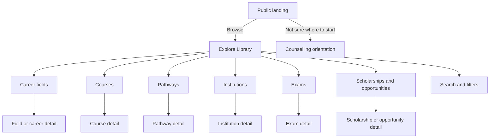
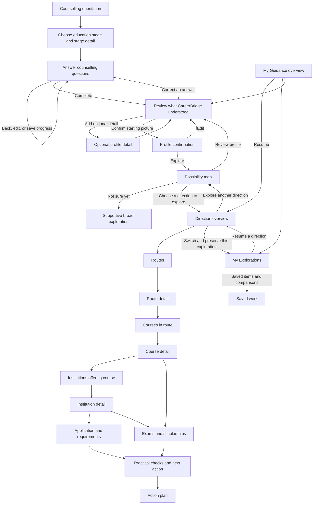

# CareerBridge Application Flow

**Status:** Working draft; current routes and intended experience are distinguished below.

## 1. Navigation model

CareerBridge has two connected but distinct areas:

- **Explore Library:** general browsing available before counselling or outside a personalized session.
- **My Guidance:** personalized exploration after the student has reviewed and confirmed a counselling profile.

Both areas may use the same underlying catalogue, but the interface must not imply that general content was personalized. A shared header may link between areas; exact global navigation and mobile treatment are design decisions still subject to review.

## 2. Explore Library flow

The exact categories, detail relationships, filter fields and pre-counselling save behavior depend on available reviewed data.

## 3. Counselling and My Guidance flow

The stage, direction and page labels above express product intent. Existing route names may differ and are recorded in `TRD.md` and `API_SPEC.md`.

## 4. Flow rules

### Before counselling

- Students can begin with general browsing or counselling.
- Browsing content is not presented as a personalized recommendation.
- If a general browse path hands off to counselling, preserve the intended destination only where the implementation supports it; return behavior is an open detail.

### Counselling

- The student chooses Class 10 or Class 12 and a relevant stage detail.
- Questions use clear language and permit "Not sure yet" where provided.
- Core questions and optional follow-up detail must be distinguishable.
- Back navigation must retain saved answers; edits update the starting picture without erasing a direction's saved exploration.
- Completion leads to profile review, not directly to an opaque recommendation.
- The student confirms a starting picture before personalized possibilities are shown.

### Possibilities

- Show a manageable number of possibilities with equal visual weight.
- Make rationale understandable and grounded in profile answers.
- Offer a non-committal unsure path.
- Never require choosing one direction to continue general exploration.

### Direction exploration

- Keep the current direction and page/section visible.
- Back links name their destination.
- Switching directions preserves each direction's useful return point and saved work.
- Related screens can be entered in context rather than only through a rigid linear wizard.
- A selected course or institution is not evidence of eligibility, current availability or admission.

### Information states

For missing, stale or unverified facts, show explicit states such as "Not provided", "Not currently confirmed", "Needs verification" or "Official source not connected". A missing value must not be rendered as zero, unavailable in reality, free, or not required.

### Saving and accounts

- Intended behavior is guest-first, with optional account creation and progress migration.
- Save behavior must accurately describe whether work is saved on the device, in an anonymous server session or to an account. Do not show a successful save message unless persistence succeeded.
- Session recovery, expiration, cross-device behavior and migration conflict handling remain to be finalized.

## 5. Current route map (repository)

### Public/general area

- `/` landing
- `/start` counselling orientation
- `/start/current-position` education stage
- `/counselling` counselling question flow
- `/explore` catalogue/field exploration
- `/explore/[slug]`, `/careers/[slug]`
- `/pathways`, `/pathways/[slug]`
- `/courses`, `/courses/[slug]`
- `/institutions`, `/institutions/[code]`
- `/exams`, `/scholarships`, `/opportunities` and detail routes
- `/compare`, `/mentor`, `/how-it-works`, `/about`
- `/sign-in`, `/sign-up`

### Personalized post-counselling area

- `/guidance/review` and `/guidance/review/details`
- `/guidance/confirm`, `/guidance/complete`, `/guidance/possibilities`
- `/guidance/direction/[slug]` and nested routes, course, institution, application, source, exam/scholarship and practical-check pages
- `/guidance/compare`, `/guidance/action-plan`
- `/guidance`, `/guidance/explorations`, `/guidance/saved`

### Administration

- `/admin` and `/admin/login`
- Catalogue, imports, source settings/history/activity, review queue, change history/proposals/conflicts, feedback flags, team/profile/settings and preview states.
- Admin routes are not part of the student journey and require authorized access.

## 6. Empty, error and exceptional paths

- No counselling profile: explain how to start; do not render empty personalized recommendations as a failure.
- Incomplete counselling: return to the next unanswered question or allow review/edit where intended.
- No suggestions: offer profile review and broad/general exploration; do not fabricate recommendations.
- No matching catalogue records: explain that none are currently listed for the selected context, not that no real-world option exists.
- Missing official source: show a disabled or clearly non-actionable source affordance and an honest status.
- API/database unavailable: show an explicit retryable error or labeled prototype fallback; never imply that a failed save was successful.
- Guest/shared device: signing out or starting a new journey must not expose the prior student's profile.
- Invalid deep link or removed item: provide a safe return destination.

## 7. Open flow decisions

- Final canonical global navigation and mobile navigation.
- Whether a student can view personalized recommendations again without an account after browser/session loss.
- Exact behavior of the "Not sure yet" path.
- Whether general Explore supports guest saves and comparisons.
- Profile version/history presentation after edits.
- Exact entry paths for caregivers, teachers and counsellors.
- Reminder setup, delivery channels and consent behavior.
