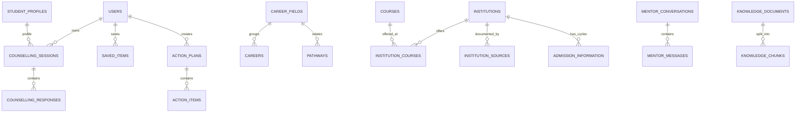

# CareerBridge Database Schema

**Status:** Documentation of the current Drizzle schema plus target considerations. The code schema is not proof of a production-integrated database.

**Implementation source:** `src/db/schema.ts`
**Database direction confirmed by project owner:** PostgreSQL with Drizzle ORM

## 1. Current schema domains

The schema uses serial surrogate IDs for many entities and stable slugs/codes for catalogue references. JSONB is used for structured lists and payloads. The schema comments describe a future-ready regions hierarchy and source/freshness tracking. Most associations are represented by code/slug columns; inspect actual database constraints before relying on referential integrity.

### Identity and profiles

- `users`: account email, name, password hash for local auth, auth provider, role and timestamps.
- `auth_sessions`: user-owned session token and expiry.
- `student_profiles`: user-owned display name, stage, district/town, completion and summary.
- `academic_profiles`: class/stream/results/performance and subject lists.
- `interests`, `strengths`, `goals`: reference vocabularies.
- `student_interests`, `student_strengths`, `student_goals`: profile-to-vocabulary responses, labels, weights and source.
- `preferences`: profile preferences/constraints such as values, location or budget.
- `admin_workspace_settings`: JSONB settings with updater metadata.

### Counselling and student journey

- `counselling_sessions`: stage, status, owner/profile or anonymous key, progress and completion timestamps.
- `counselling_responses`: session question key/text/type, selected values or free text.
- `saved_items`: user-owned saved catalogue references.
- `comparisons`: comparison state (see schema for exact fields).
- `action_plans`, `action_items`: user-owned plans and ordered checklist items/status.
- `recommendations`, `recommendation_reasons`: generated references, internal ordering value, headline and explainable reason factors.

The implementation also uses browser cookies for anonymous journey and exploration state. Those cookies are not listed as database tables.

### Career and education catalogue

- `regions`: region hierarchy and optional coordinates.
- `career_fields`: educational descriptions and tags used for recommendation explanations.
- `careers`, `career_skills`: role descriptions, connections and skill guidance.
- `pathways`: entry stage, route type, description, steps and linked course/exam slugs.
- `courses`: level, typical details, field relationships, notes, source and verification status.
- `institutions`: identity, location, type/ownership, offered levels/fields, source and verification fields.
- `institution_courses`: institution/course availability relationship and verification.
- `institution_sources`: source references, source type, priority/status and retrieval timestamp.
- `admission_information`: cycle- and institution/course-specific dates, process, document status, fee notes and source/freshness information.
- `entrance_exams`: conducting body, eligibility, cycle dates, documents, preparation and source/verification fields.
- `scholarships`: provider, eligibility, support, cycle, deadline, documents and source/verification fields.
- `opportunities`: additional catalogue opportunities (exact semantics should be confirmed against schema and data usage).

### Review, source operations and audit

- `source_refresh_settings`: source-specific enablement, frequency and fetch method preference.
- `admission_information_drafts`, `scholarship_review_drafts`: draft/review payloads separate from approved records.
- `data_imports`: dataset label, filename, count, importer notes and timestamp.
- `audit_events`: actor, action, entity reference and metadata.
- `catalogue_change_proposals`: proposed field changes with evidence and decision history.
- `catalogue_source_conflicts`: competing source evidence and review decision history.
- `feedback_flags`: student-reported catalogue issues (see schema for fields).
- `seed_meta`: catalogue seed version and applied timestamp.

### Mentor knowledge

- `mentor_conversations`, `mentor_messages`: conversation and message/citation records.
- `knowledge_documents`, `knowledge_chunks`: retrieval content, source/scope, verification and embeddings stored as JSONB.

## 2. Data ownership and relationships

Conceptually:

This is a conceptual relationship map, not a claim that every relation is protected by a database foreign-key constraint. Verify the deployed DDL and add constraints/indexes intentionally before production use.

## 3. Source and freshness semantics

The current schema has several verification-status strings and source/retrieval/verification timestamps. These must be normalized into an agreed vocabulary and documented before the API/UI treats them as a stable contract.

Required target behavior:

- Keep a blank field distinct from a confirmed negative or "not required".
- Record source URL/title/type and the date retrieved/checked for changing facts.
- Keep unreviewed proposals and drafts out of approved student-facing reads.
- Retain audit and decision history for material changes.
- Represent cycle-specific dates and eligibility with cycle/context rather than merging facts from different years.

## 4. Prototype and migration notes

- `src/db/index.ts` builds a PostgreSQL pool from `DATABASE_URL` and has a local default connection string for development.
- `src/db/seed.ts` seeds bundled TypeScript data and a knowledge corpus. Its comments state that institution data is a sample requiring verification.
- `src/services/catalog.ts` can fall back to bundled seed content when the DB is unavailable or returns no rows.
- `src/db/migrations/README.md` says supplemental SQL migrations are manually applied and have no automatic runner/journal in the repository. It also warns that numeric prefixes are duplicated.
- The precise state of any deployed database and which supplemental migrations have been applied is unknown.

Before production use, establish one migration strategy, reconcile existing databases, define database constraints, test backups/restores, and identify which seed records are approved.

## 5. Target schema questions

- Are anonymous counselling sessions retained server-side, cookie-identified, or both? For how long?
- What exact records migrate when a guest signs up, and how are conflicts resolved?
- Should profile versions and recommendation snapshots be first-class records?
- What is the authoritative normalized data model for workbook file, sheets, row errors, staging, approvals and rollback?
- Should source facts be stored as field-level observations/history rather than only a current value plus a source URL?
- What deletion/retention policy applies to student data, mentor conversations and audit records?
- Which entities need enforced foreign keys, uniqueness rules, tenant/role scoping and indexes?
- Are reminder/notification preferences in scope for an initial release?

## 6. Schema change procedure (target)

1. Confirm the product/data requirement and ownership of the affected fields.
2. Update Drizzle schema and migration with a unique, ordered migration identifier.
3. Review compatibility and data backfill/rollback implications.
4. Test migration against a disposable database and representative seed/import data.
5. Record migration application in the chosen migration system.
6. Update this document, `TRD.md`, `API_SPEC.md` and relevant tests.
