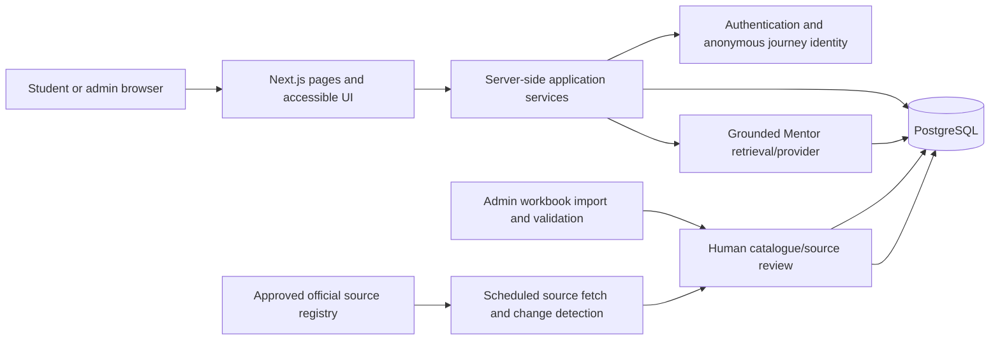

# CareerBridge Technical Requirements and Architecture

**Status:** Working draft. Existing repository behavior is implementation evidence; target architecture statements are proposals unless explicitly confirmed by the project owner.

## 1. Technical direction

The repository is a Next.js App Router and TypeScript application. The project owner has confirmed PostgreSQL with Drizzle ORM as the intended database direction. Tailwind CSS, Playwright and ESLint are present in the current package configuration.

The current application is a prototype. Bundled seed data, fallback behavior, schema and route handlers must not be described as proof that production integrations are complete.

## 2. Current repository stack

| Concern | Observed in repository | Status / caveat |
|---|---|---|
| Web application | Next.js App Router, React, TypeScript | Present |
| UI styling | Tailwind CSS 4 and CSS design tokens | Present; many screens also use inline utility colors |
| Database access | PostgreSQL `pg` pool and Drizzle ORM | Code/schema present; production connection/integration not verified |
| Catalogue data | TypeScript seed modules, catalog service, DB seeding | Sample/hardcoded content and fallback paths remain |
| Authentication | Auth abstraction; Clerk adapter when configured, local Postgres session fallback | Code present; provider and target production operations need confirmation |
| API | Next.js route handlers under `src/app/api` | Handlers exist; not a finalized stable API contract |
| Admin | Catalogue, source, import, review, audit and change proposal surfaces | Significant prototype implementation; migration prerequisites apply |
| Mentor | Retrieval/content service and optional provider configuration | Provider, retrieval corpus, operating controls and production readiness need validation |
| Tests | Playwright browser specs | Present; package scripts do not currently define `test` |
| Formatting | No Prettier dependency/script in the observed `package.json` | Do not claim configured until added/confirmed |

`package.json` currently defines `dev`, `build`, `start`, `lint` and `typecheck`. Playwright is available as a dependency and uses `playwright.config.ts`; tests are configured to use an already-running server with `CAREERBRIDGE_TEST_URL` or `http://localhost:3000`.

## 3. Proposed logical architecture

The following is a conceptual architecture aligned with project intent. It is not an approved deployment topology.

Whether the fetcher is a separate worker, scheduled platform job or manual operator task is not decided. The diagram represents responsibilities, not a commitment to a particular cloud provider or runtime.

## 4. Application boundaries

### Presentation layer

- Public/general and personalized route groups remain distinct in user-facing meaning.
- Pages should compose UI components and call server-side application services; client components should not connect directly to PostgreSQL or hold provider secrets.
- Shared catalogue content may be rendered in both experiences, with explicit general/personalized context.

### Application/service layer

- Owns counselling state transitions, profile review/confirmation, recommendation generation, exploration state, saves, comparisons, action plans, catalogue search and admin workflows.
- Validates input at trust boundaries.
- Applies authorization before reading or mutating student- or admin-owned records.
- Keeps recommendations explainable and avoids presenting internal ordering signals as confidence or probability.

### Persistence layer

- PostgreSQL is the intended persistent store, accessed using Drizzle.
- Separate student/anonymous journey data from reviewed catalogue records and source evidence.
- Keep drafts/proposals distinct from approved student-facing facts.
- Preserve source metadata, import history and audit events for catalogue governance.
- Ensure migrations and schema changes have a reproducible, recorded process.

## 5. Data ingestion and source update architecture

### Stable catalogue information

Working plan: maintain relatively stable records (for example names and locations) in Excel workbooks and make them usable through the admin workflow.

Recommended pipeline, with individual validation rules still to be specified:

1. Upload workbook and preserve the original file or an immutable reference to it.
2. Parse workbook rows into a staging/import record.
3. Validate required fields, identifiers, duplicates, relationships and values.
4. Show row-level errors and a reviewable diff.
5. Allow an authorized reviewer to approve, reject or correct rows.
6. Publish approved rows to the operational catalogue.
7. Record importer, workbook/version, timestamp, reviewer and audit trail.

This sequence is consistent with the project PDF's review-before-publication principle. Storage location, workbook template, accepted formats, limits, rollback and approval roles are open.

### Time-sensitive facts

The project owner's current plan is periodic fetching from official sources followed by review before display. The repository documentation also notes that a scheduled fetcher/parser is not yet implemented.

Recommended safety properties:

- Maintain an approved list of sources and the fields each source is authoritative for.
- Record URL, source title/type, retrieval time, fact cycle/context, evidence and parser/fetch outcome.
- Store fetched changes as proposals, not direct student-facing updates.
- Compare proposal values with current approved values and surface source conflicts for human review.
- Publish only reviewed values; keep old approved values and decision history auditable.
- Show freshness and uncertainty to students, including when retrieval fails or a source is not connected.

The schedule, allowable source types, fetching technology, automated approval exceptions, source terms/compliance review and stale-data thresholds are undecided. Do not use arbitrary web scraping or imply that refresh settings mean a refresh ran.

## 6. Identity, privacy and security requirements

- Support the intended guest-first experience and optional accounts; exact migration behavior must be tested and specified.
- Keep student answers and saves scoped to an anonymous journey or authenticated owner.
- Use secure, HTTP-only cookies for session identifiers; never place passwords or sensitive profile data in client-readable identity tokens.
- Require role checks on admin pages and admin APIs; default-deny admin access.
- Validate and bound request bodies, uploads and search/filter inputs.
- Protect against cross-student data access, unsafe redirects, CSRF where applicable, session fixation and abuse of anonymous endpoints.
- Use least privilege for database credentials and source/provider secrets.
- Avoid collecting exact home addresses, private financial documents and unrelated sensitive data.
- Define retention, deletion, consent and minor-specific controls before a production launch.
- Log operational and security events without unnecessarily logging counselling answers or secrets.

These are requirements for the target, not a certification that the prototype has passed a security review.

## 7. Reliability, accessibility and performance

- Clearly surface database/API errors; distinguish fallback prototype content from saved/published data.
- Do not report successful persistence when a write failed.
- Design responsive layouts; the Project Summary proposes checking widths 320, 390, 768, 1024 and 1440 pixels.
- Use semantic HTML, keyboard access, clear focus, assistive labels and reduced-motion behavior.
- Establish measurable performance, availability, backup/recovery and accessibility acceptance thresholds before launch; none are currently agreed.

## 8. Configuration and environments

`.env.example` documents `DATABASE_URL` and optional Clerk, AI-provider and Google Maps configuration. Actual environment ownership, secret management, deployment environments, database hosting, backups, observability and production provider choices are not confirmed here. Never copy `.env` values into documentation or commit secrets.

## 9. Database migration status

`src/db/schema.ts` defines a broad Drizzle schema. `src/db/migrations/README.md` describes the SQL files as manual supplemental migrations without an automatic runner or migration journal, and notes duplicate numeric prefixes. A production migration strategy should be resolved before depending on these files for live data.

## 10. Architecture decisions still open

- Production hosting, database provider, environment topology and operational ownership.
- Stable API contract and versioning policy.
- Authentication provider and production account operations.
- Anonymous journey retention and guest-to-account conflict/merge rules.
- Workbook storage, validation rules and rollback design.
- Source fetching runtime, scheduling, legal/terms review and human review queue SLA.
- Mentor model/provider, corpus approval, privacy, rate limits, fallback and monitoring.
- Production backup, restore, audit retention and incident handling.
